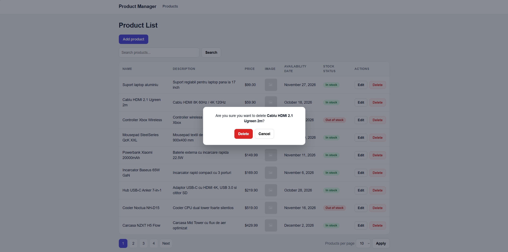
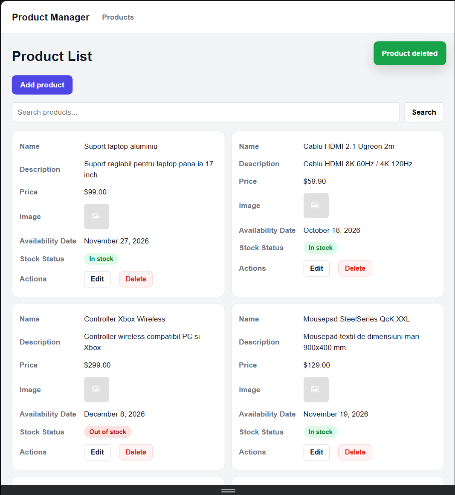
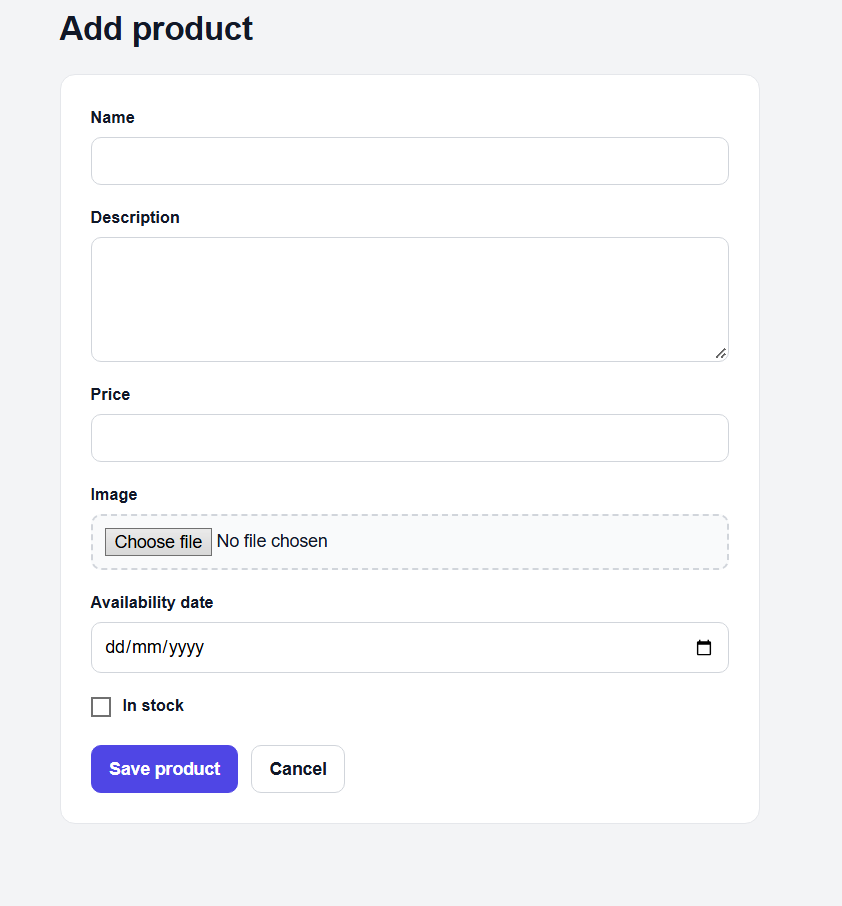
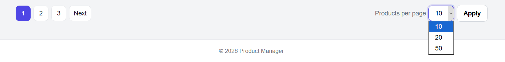

# Product Management System

A CRUD application for managing products, built with plain PHP, MySQL and HTML/CSS/JavaScript (no frameworks).

## Features

- **Product list:** a table with name, description, price, image, availability date and stock status
- **Server-side pagination:** 10, 20 or 50 products per page
- **Search** by product name
- **Create / Edit:** server-side validation and image upload (JPG, PNG, GIF, WebP, max 2 MB)
- **Delete** with a confirmation modal, done via AJAX (falls back to a normal form submit without JavaScript)
- **Success and error messages** for every operation
- **Responsive design:** the table turns into cards on tablets and phones (CSS Grid / Flexbox)
- **Security:** PDO prepared statements, output escaping with `htmlspecialchars`, image type and size checks

## Requirements

- PHP 8+ (with the PDO MySQL extension)
- MySQL or MariaDB
- A local server such as XAMPP

## Setup

1. Clone the repository into your web server folder (e.g. `C:\xampp\htdocs`):
   ```
   git clone https://github.com/hutanstefan/ProductManagerSystem.git
   ```
2. Create the database and the `products` table:
   ```
   mysql -u root < database/database.sql
   ```
3. (Optional) Load the test products seeder:
   ```
   mysql -u root < database/seed.sql
   ```
   You can also import both files from phpMyAdmin.
4. If your MySQL credentials differ from the XAMPP defaults (`root`, no password), update them in `config/config.php`.
5. Make sure the web server can write to the `uploads/` folder.
6. Open `http://localhost/ProductManagerSystem/` in the browser.

## Project structure

```
actions/       delete endpoint (form + AJAX)
assets/        CSS, JavaScript and the placeholder image
config/        database settings and page size options
database/      table schema and seed data
includes/      PDO connection, helper functions, header and footer
uploads/       uploaded product images
index.php      product list (search, pagination, delete modal)
form.php       create / edit product form
```

## Screenshots

**Product list on desktop with the delete confirmation modal**



**Responsive card layout and success message**



**Add / edit product form**



**Pagination and page size selector**



## Note

The data in `database/seed.sql` is generated with help of AI for test data.
